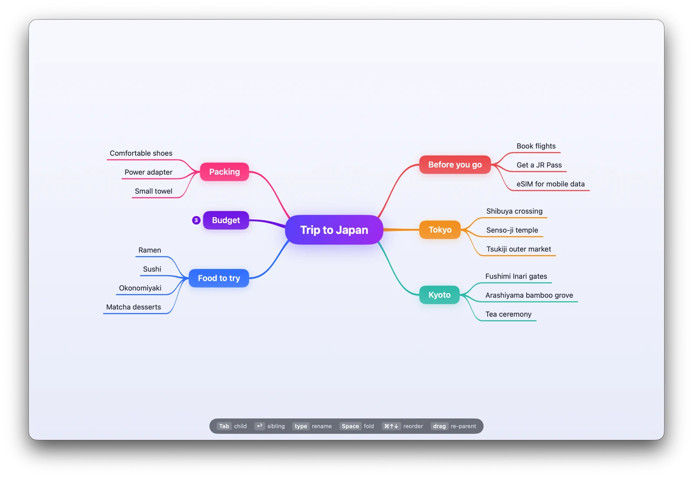
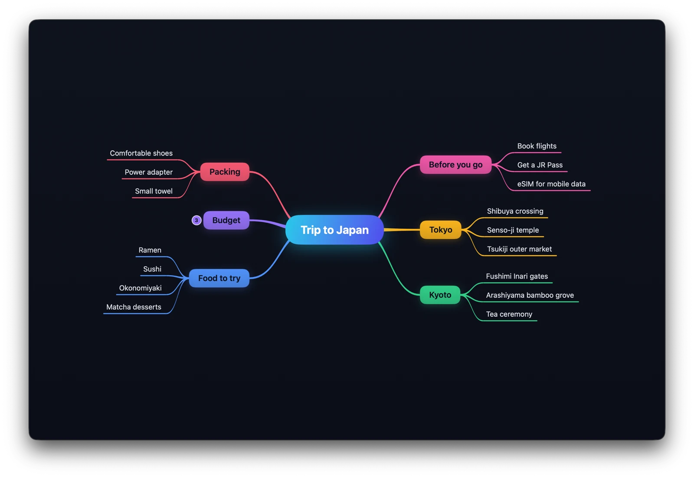
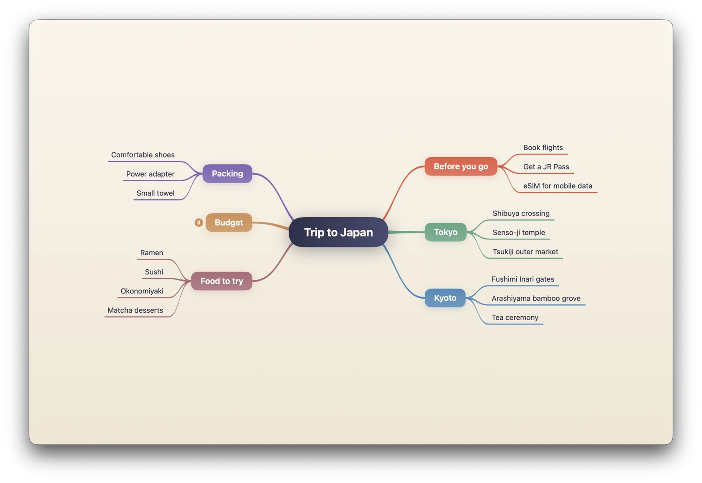
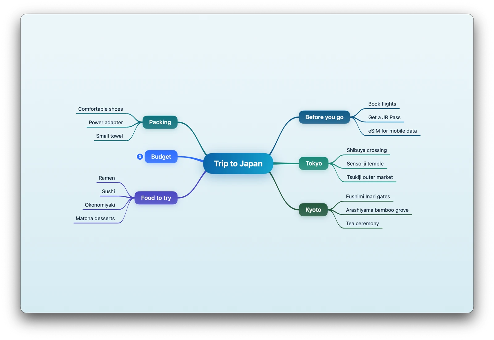
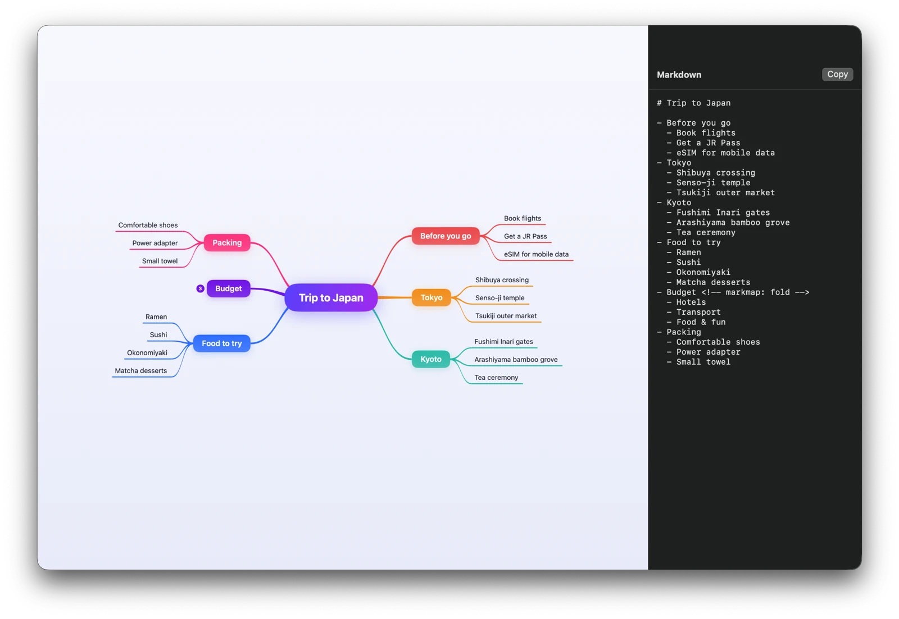
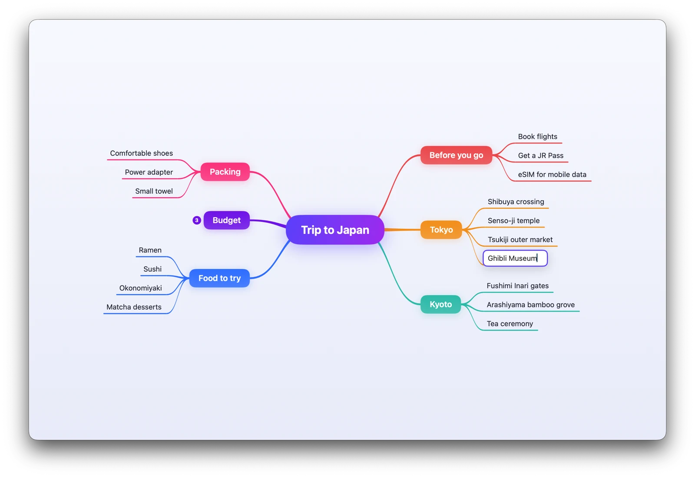

<div align="center">

# Mindmap Markdown

**Beautiful mind maps for your Mac — saved as simple text files you'll never lose.**



</div>

---

## What is it?

A **mind map** is a picture of your thoughts: one big idea in the middle, with related ideas
branching out around it. It's a great way to plan a trip, brainstorm a project, take notes in a
class, or untangle a busy week.

**Mindmap Markdown** is a free Mac app for making mind maps that look lovely and are quick to
build — mostly with the keyboard, so your ideas flow as fast as you can type them.

What makes it different: every map is saved as an ordinary **text file** (a "Markdown" file,
ending in `.md`). That means your maps are never locked inside one app. You can open them in
Notes-style apps like Obsidian, read them in any text editor, or email them to a friend — and
they'll still make sense.

## Why you'll like it

- 🎨 **Looks great out of the box** — smooth, colourful branches and five hand-picked themes.
- ⌨️ **Fast to build** — press **Tab** for a new idea, **Return** for the next one, and just type.
- 🧘 **Distraction-free** — the top bar disappears while you work and comes back when you need it.
- 📄 **Your notes stay yours** — plain text files, saved on your Mac, no account, no internet needed.
- ↩️ **No fear of mistakes** — every change can be undone with **⌘Z**.
- 🖼️ **Easy to share** — export your map as a picture (PNG) in one click.

---

## Pick your look

Five themes, from bright to calm to dark. Switch any time from the **palette** button in the top bar.

<table>
  <tr>
    <td align="center"><br><b>Midnight</b> — easy on the eyes at night</td>
    <td align="center"><br><b>Paper</b> — warm and calm, like a notebook</td>
  </tr>
  <tr>
    <td align="center"><br><b>Ocean</b> — cool blues and greens</td>
    <td align="center"><br><b>Blossom</b> — soft pinks and corals</td>
  </tr>
</table>

The map at the top of this page uses **Aurora**, the default theme. You can also choose whether
branches spread out on **both sides** of the central idea (balanced) or all to the **right**.

---

## Your map is just a text file

Click the **document** button in the top bar to see exactly what gets saved. On the left is your
map; on the right is the same map as plain text.

<div align="center">

</div>

The format is easy to read even without the app:

```markdown
# Trip to Japan

- Tokyo
  - Shibuya crossing
  - Senso-ji temple
- Food to try
  - Ramen
  - Sushi
```

The `#` line is the big idea in the middle. Each `-` line is a branch, and indenting a line
puts it *under* the one above. That's all there is to it — so you can even write a map by hand
in any text editor and open it in Mindmap Markdown.

---

## Getting started

### What you need

- A Mac running **macOS 14 Sonoma or newer**.
- About 10 minutes for the one-time setup below.

### Install (one time)

There's no App Store version yet, so you build the app on your own Mac. It sounds technical,
but it's just four commands you copy and paste — the Mac does the rest.

1. **Open Terminal.** Press **⌘ Space**, type `Terminal`, and press **Return**.

2. **Install Apple's free developer tools.** Copy this line into Terminal and press **Return**:

   ```bash
   xcode-select --install
   ```

   A window pops up — click **Install** and wait until it finishes (a few minutes).
   If it says the tools are *already installed*, that's fine — go to the next step.

3. **Download Mindmap Markdown.** Copy these two lines into Terminal and press **Return**:

   ```bash
   git clone https://github.com/binhphuong-ab/mindmap-markdown.git
   cd mindmap-markdown
   ```

4. **Build and install the app.** Copy this line and press **Return**:

   ```bash
   ./build.sh
   ```

   After a minute or so you'll see `installed /Applications/Mindmap Markdown.app`. Done! 🎉

You'll now find **Mindmap Markdown** in your **Applications** folder and in Launchpad.
You can close Terminal.

### Open it

Double-click **Mindmap Markdown** in Applications. Choose **File ▸ New** to start a fresh map,
or **File ▸ Open…** to open an existing `.md` file.

> **Tip:** to open `.md` files with Mindmap Markdown by double-clicking them in Finder,
> right-click any `.md` file ▸ **Get Info** ▸ under *Open with* pick **Mindmap Markdown** ▸
> click **Change All…**

---

## Make your first map in one minute

<div align="center">

</div>

1. **Name your big idea.** A new map starts with *Central Idea* in the middle and a few example
   branches (rename or delete them as you like). The central idea is already selected — just
   start typing to replace it, then press **Return**.
2. **Add a branch.** Press **Tab**. A new box appears; type your idea and press **Return**.
3. **Add the next branch.** Press **Return** again for another idea at the same level.
4. **Go deeper.** With an idea selected, press **Tab** to add a smaller idea *under* it
   (that's how "Ghibli Museum" is being added under "Tokyo" in the picture above).
5. **Move around** with the arrow keys, or just click any idea.
6. **Save** with **⌘S**. The file is named after your big idea automatically
   (a map called *Trip to Japan* saves as `Trip to Japan.md`).

That's the whole rhythm: **Tab** to go deeper, **Return** for the next idea, and type.

---

## Cheat sheet

### Keyboard

| To do this… | Press |
|---|---|
| Add an idea **under** the selected one | **Tab** |
| Add an idea **next to** the selected one | **Return** |
| Rename the selected idea | just start typing (or double-click it) |
| Finish typing | **Return** (or **Tab** to finish *and* add an idea under it) |
| Cancel typing | **Esc** |
| Delete an idea (and everything under it) | **Delete ⌫** |
| Hide / show the ideas under one | **Space** |
| Move between ideas | **← → ↑ ↓** |
| Move an idea up / down in its list | **⌘↑** / **⌘↓** |
| Undo / redo | **⌘Z** / **⇧⌘Z** |
| Zoom in / out | **⌘ =** / **⌘ −** (or pinch on the trackpad) |
| Fit the whole map in the window | **⌘ 9** |
| Back to normal size | **⌘ 0** |
| Save | **⌘S** |

### Mouse & trackpad

| To do this… | Do |
|---|---|
| Select an idea | click it |
| Rename an idea | double-click it |
| Move an idea to a different branch | drag it onto its new parent |
| Hide / show the ideas under one | click the small bubble at the end of its branch (**−** on the selected idea, a number when ideas are hidden) |
| Scroll around a big map | two-finger swipe on the trackpad |
| Zoom | pinch on the trackpad |

---

## Handy features

- **Fold away detail.** Press **Space** on an idea to tuck its branches away. A small bubble shows
  how many ideas are hidden; press **Space** again (or click the bubble) to bring them back.
- **The top bar hides itself.** After a few seconds the title and buttons fade away so the map
  fills the window. Move your mouse to the **top edge** of the window to bring them back.
  Prefer it always visible? Palette button ▸ untick **Auto-hide Toolbar**.
- **File name follows your big idea.** Rename the central idea and the file on your Mac is renamed
  to match. (Turn this off with Palette button ▸ **Name File After Central Topic**.)
- **Save as a picture.** Click the **share** button in the top bar to export the map as a
  high-resolution PNG — perfect for slides, chats or printing.
- **Autosave.** Like other Mac apps, your work is saved as you go, and **File ▸ Revert To** lets
  you go back to an earlier version.
- **Shortcut reminder.** The little bar at the bottom of the window lists the main keys. Hide it
  with Palette button ▸ **Show Shortcut Hints**.

---

## Questions

**Where are my maps saved?**
Wherever you choose when you first save — just like a Word or Pages document. They're ordinary
`.md` files you can see in Finder, back up, or put in iCloud Drive or Dropbox.

**Is anything uploaded to the internet?**
No. The app works completely offline and never sends your maps anywhere.

**Can I open my maps in other apps?**
Yes. Any app that reads Markdown can open them — for example **Obsidian**, **Typora**,
**VS Code**, or plain **TextEdit**. They'll appear as a tidy outline.

**Can I open my existing notes as a mind map?**
Often, yes. Headings (`#`, `##`, `###`) and bullet or numbered lists all turn into branches.

**I deleted something by mistake!**
Press **⌘Z** to undo. You can undo many steps back.

**Why does the big idea in the middle not delete?**
Every map needs one central idea, so it can't be deleted — but you can rename it any time.

**How do I update to a newer version?**
Open Terminal and run these two lines:

```bash
cd mindmap-markdown && git pull
./build.sh
```

---

## For developers

<details>
<summary>Build options, file format details and code layout</summary>

### Build

```bash
./build.sh               # build + install to /Applications
./build.sh --no-install  # build "./Mindmap Markdown.app" only
```

Needs only the Xcode Command Line Tools (Swift 5.10+, macOS 14+). The app is ad-hoc signed.

### File format

Markmap-compatible Markdown: `# Root`, then a nested `- ` list (two-space indent). Folded
branches carry Markmap's `<!-- markmap: fold -->` marker. On input, `##`/`###` headings,
`-`/`*`/`+`/`1.` lists, task boxes and YAML front matter are also understood.

```markdown
# Central Idea

- Branch
  - Leaf
- Folded branch <!-- markmap: fold -->
  - Hidden leaf
```

### Code layout

| File | Role |
|---|---|
| `MindNode.swift` | value-type tree + edit operations (index-path addressed) |
| `MarkdownCodec.swift` | Markdown ⇄ tree |
| `MindMapDocument.swift` | `ReferenceFileDocument`, explicit undo |
| `MindLayout.swift` | measures text, places topics (balanced left/right tree) |
| `MapCanvas.swift` | tapered Bézier branches in one `Canvas`, topic views, fold badges |
| `FileNameSync.swift` | keeps the file name equal to the central topic (`NSDocument.move`) |
| `ChromeAutoHider.swift` | fades the whole title bar out / in on hover |
| `EditorField.swift` | AppKit text field for in-place renaming |
| `ContentView.swift` | selection, keyboard, zoom, drag, toolbar, export |

Note: the macOS 27 SDK implements SwiftUI's `@State` as a macro whose plugin ships only with
full Xcode, so view state lives in an `ObservableObject` (`EditorUIState`) instead.

</details>

---

## License

Free and open source under the [MIT License](LICENSE) — you're welcome to use, share and change it.
